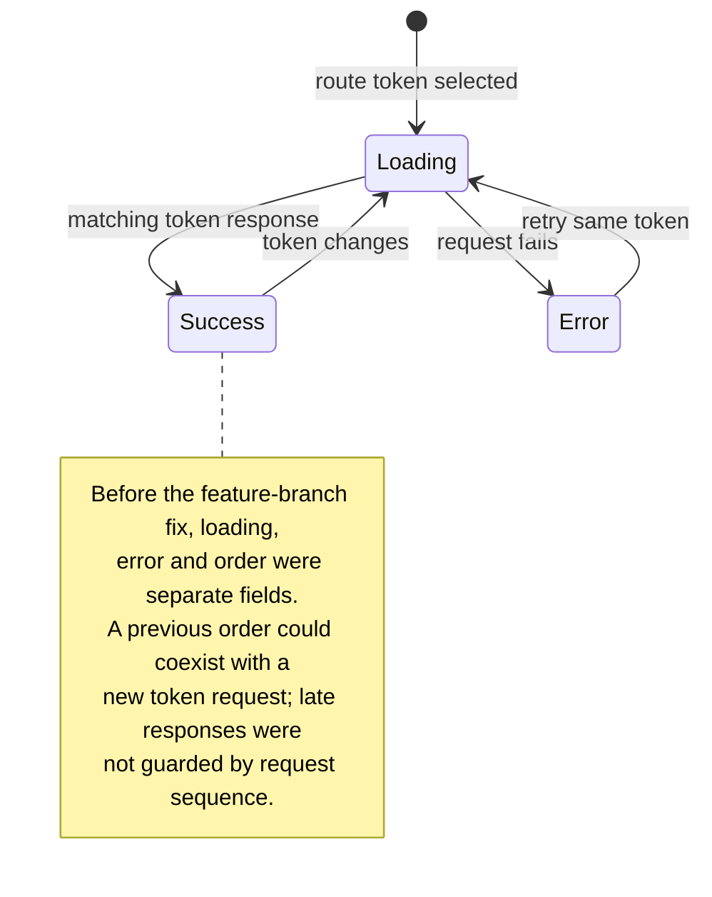
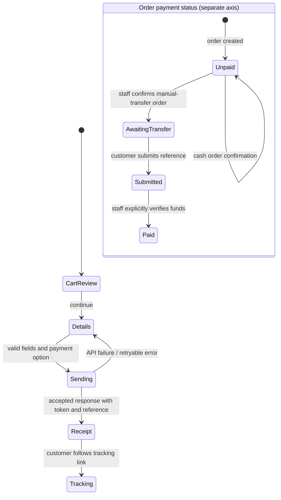

# Cloud L State-Machine Audit

**Scope:** Synthesis of independent code-review findings across customer, staff, API, persistence, routing, and monitoring workflows. The selected tracking-state fix and mocked E2E coverage are implemented on local branch `feat/explicit-state-machines`; **no database, production configuration, merge, push, or production deployment was performed.**

## Executive summary

Most workflows are implemented as ordinary React state, predicates, and API/database guards rather than end-to-end typed state machines. That is not by itself a defect: important invariants are enforced at API or SQL boundaries in several paths. The highest-impact cross-cutting risk was the customer tracking page’s unscoped combination of `loading`, `error`, and `order` state: changing between valid tracking hashes could leave a previous order visible or allow a late response to overwrite the newer request. The narrow fix is implemented on the feature branch: a token-scoped discriminated union, a token-keyed page instance, and request-sequence invalidation hide prior private data and ignore superseded responses. This improves UX and privacy, makes the lifecycle exhaustive for maintainers, and gives future agents a deterministic state model and regression contract without rewriting order workflows.

The strongest verified safeguards are server-side catalog reconstruction and availability/payment-method checks for order creation; transactional guards for status and customer-edit changes; signed, expiring staff cookies; and per-order payment-destination snapshots. Several other weaknesses are chiefly missing tests or model expressiveness, not evidence of observed production failures. See workflow-specific caveats below.

## Inventory

| Discovery domain | State representation / primary owner | Important observed guards and transitions | Main audit risk / coverage gap |
|---|---|---|---|
| Menu discovery and item selection | `FoodMenu.tsx` and `DrinksMenu.tsx`: local query/filter state; drink category union and item-to-variant map; availability set in `App.tsx` | Filters compose; sold-out controls disable; cart additions merge by selection ID; create API rebuilds catalog details and rechecks availability | Selection/cart contracts are structurally asymmetric; drink variant-to-cart identity and direct sold-out UI behavior lack E2E assertions. Availability is advisory until server validation. |
| Customer cart and persistence | Module snapshot/store in `App.tsx`; `CartLine`/`OrderSelection` in `orderTypes.ts`; drawer and checkout modes in `OrderCart.tsx` | Interactive add/quantity limits; edit draft is isolated from saved cart; successful accepted placement clears cart; API validates catalog IDs and quantities | Hydration validates shape, not semantic catalog/price/uniqueness/limits; no storage-event sync for cart; checkout/cart lifecycle and reorder replacement lack focused tests. |
| Browser-local favorites | `favoritesStore.ts` snapshot; menu-local filters; `FavoriteButton.tsx` | Normalizes nonblank unique IDs; writes localStorage; subscribes to cross-tab storage events; E2E covers keyboard, reload, filtering | Browser-only by design; storage errors are silent; unknown IDs persist; cross-tab path is implemented but untested. |
| Customer order request and checkout | `CheckoutForm.tsx` stage union plus independent payment-method and receipt state; `api/orders.ts` | Server transaction reconstructs current catalog values, checks availability and enabled payment method, inserts order/items/event; client clears cart after accepted success | In-flight cart changes/dismissal can race with success and hide receipt or clear newer changes; no checkout-specific E2E coverage or visible idempotency key. Timing-specific losses are code-level risks, not tested executions. |
| Fulfillment status | `StaffOrders.tsx`, `OrderTrackingPage.tsx`, `api/admin/orders/[id].ts`; SQL status allowlist | API locks order, validates transition map, gates preparation on payment for non-cash, and writes customer-visible event transactionally | Status is plain strings across UI/API; API transition map does not enforce fulfillment-specific `ready_for_pickup` vs `out_for_delivery`; customer journey omits delivery and terminal statuses. Real lifecycle integration tests absent. |
| Private tracking and reorder | Hash token in `App.tsx`; fetch/render/reorder in `OrderTrackingPage.tsx`; tracking/reorder projection in `api/orders.ts` | Token is validated and stored hashed; reorder uses current catalog/current prices, checks availability, and does not carry old order details; token-change/late-response/retry UI paths now have mocked E2E coverage | Token-scoped UI race is fixed and tested. Real tracking/reorder API integration and progress projection for out-for-delivery, delivered, declined, or cancelled remain untested/open. |
| Customer pending-order edits | Separate App edit draft/token/error/saving fields; API transaction in `api/orders.ts`; `005_customer_order_edits.sql` | Feature/host and order eligibility gates; API rechecks under row lock, revalidates current catalog/availability, replaces items/subtotal and audits; conflict cases covered by mocked E2E | Independent fields allow drift; tests mock server transaction and omit needs-clarification/authorization/real concurrency cases. Migration 003 adds `needs_clarification` to the status constraint; do not assess against migration 001 alone. |
| Manual-payment settlement | Separate `payment_status` and order `status`; checkout, tracking and staff components; payment APIs | Manual orders start unpaid; confirmation enables awaiting-transfer; customer reference submission sets submitted; explicit staff verification marks paid; non-cash preparation is blocked before paid | No focused payment lifecycle tests. SQL constrains allowed values, not most cross-field/transition combinations; inspected reference/verification endpoints do not require a particular order status. Cash is a separate non-transfer path. |
| Staff authentication | Hash route/UI state in `App.tsx`/`StaffOrders.tsx`; signed cookie and shared guard in `api/_server.ts` | Eight-hour signed HTTP-only cookie; each protected request validates it; queue 401 returns UI to login; rate limiting is process-memory | No typed session lifecycle or auth E2E. Child admin 401 responses do not uniformly trigger immediate parent reauthentication; logout network-failure behavior is not established. |
| Staff payment destinations | `StaffPaymentSettings.tsx`, `api/admin/payment-methods.ts`, `api/payment-methods.ts`, migration 004 | Create disabled; enabled-only public listing; order create rechecks enabled status; order-specific snapshots preserve prior instructions across later changes; audit rows are written | No destination-specific tests. Shared staff session has no distinct owner role in the inspected API; snapshot shape/immutability is application convention, not a database constraint. |
| Menu availability | Staff UI/API and `App.tsx` advisory polling; transaction locks in create/edit APIs | Staff writes use shared advisory locks; create/edit recheck selected items transactionally; historical order items remain snapshots | Customer state cannot distinguish unavailable/stale fetch from available. Staff UI discards authoritative PATCH item and depends on refresh, so refresh failure can leave stale controls after successful write. No direct availability tests. |

## Cross-cutting controllers

These controllers span the workflow inventory rather than owning a separate customer or staff business process:

- **Hash routing** (`src/App.tsx`): the initial hash and each `hashchange` select one of three implicit route states: main site (any unrecognized/non-staff hash), staff (`#staff`), or private tracking (`#track/` plus a 40–50 character URL-safe token). Rendering gives tracking precedence over staff, then falls back to the main site. Staff and tracking chunks are lazy-loaded behind the same accessible Suspense fallback. Route state is represented by a tracking-token string sentinel and a separate staff boolean, not one route union.
- **React fatal-error fallback** (`src/monitoring/AppErrorBoundary.tsx`, `src/main.tsx`): the boundary has a two-state `hasError` boolean. A caught descendant render/lifecycle error is captured and switches the whole app to a bilingual assertive fallback; its recovery action reloads the page rather than resetting the boundary in place. This path is explicit and no defect is established by inspection.
- **Sentry initialization/capture** (`src/monitoring/sentry.ts`): monitoring is disabled unless a DSN exists, the build is production, and the hostname is allowlisted. When enabled, initialization is deferred to idle time (or a 1.5-second timeout); boundary capture can request the same shared SDK-loading promise immediately. The promise resolves to the initialized SDK or `null`. Before sending, the sanitizer removes user/request/context/free-form fields, redacts exception messages, and strips sensitive stack-frame details. This is an infrastructure lifecycle, not a customer workflow; no secrets or production telemetry were inspected.

## Highest-risk workflow diagrams

### Private tracking load and token changes



**Audit interpretation:** the original stale-display/late-response risk was inferred from unguarded state updates, not from a production incident. The implemented fix scopes rendered state to a single token; route-mocked tests now demonstrate that a delayed old-token response cannot replace the new token's order.

### Order creation and manual-payment progression



**Audit interpretation:** the order fulfillment status and payment status are separate dimensions, not one combined state machine. The API’s transactional checks are stronger than the client’s advisory state. The diagram shows implemented code paths, not evidence that every transition has occurred in production. The findings note that reference submission/verification lack an order-status guard; policy intent is unresolved, so this report does not recommend changing that behavior in the proposed patch.

## Selected and implemented minimal explicit-state refactor

**Refactor only tracking request state in `src/components/OrderTrackingPage.tsx`.** Replace independently coordinated `loading`, `error`, and `order` fields with a discriminated union scoped to the route token, conceptually:

```ts
type TrackingState =
  | { kind: 'loading'; token: string }
  | { kind: 'error'; token: string; message: string }
  | { kind: 'success'; token: string; order: Order };
```

When the token changes, enter `loading` for that token and do not render the previous token’s order. On completion, update state only if the response still belongs to the current token and request sequence. Keep retry on the current token. Preserve API endpoints, token format, status/payment projections, reorder eligibility, and successful tracking behavior. The union’s `kind` is the single rendering switch; the existing `role="status"` loading and `role="alert"` error semantics remain. Same-token payment-reference refresh keeps the existing order visible while refreshing and displays a recovery message if that refresh fails. Three focused E2E scenarios now cover a late response after switching tokens, same-token refresh failure, and retry after an initial lookup error.

This is preferred over broader recommendations because one local state union addresses a concrete privacy/UX hazard, reduces contradictory combinations for DX, and provides a direct accessible rendering path. It does not require changing order, payment, cart, or authentication protocols.

## Implementation and validation

- `src/App.tsx` keys the lazy tracking component by the private tracking token, resetting all page-local state when a customer opens a different link.
- `src/components/OrderTrackingPage.tsx` uses the token-tagged `loading | error | success` union, ignores superseded request results, keeps same-token payment-reference refresh behavior intact, and preserves the prior order with an explicit message if only that refresh fails.
- `e2e/tracking-state.spec.ts` covers token-switch privacy/late-response ordering, same-token refresh failure, and 404-to-success retry. The endpoint responses are mocked; no production records are touched.
- `npm run build` passed. `npm run lint` reported 0 errors and 15 warnings in the unrelated `reference/Home.tsx` prototype; focused lint on all changed TypeScript files reported 0 warnings/errors.
- The complete Playwright suite passed **16/16**. `git diff --check` passed. An independent read-only code review found no blocking issues.
- The changes remain local to `feat/explicit-state-machines`; no push, merge, migration, database write, environment-variable change, or deployment was performed.

## Non-goals and safety constraints

- No framework/state-management rewrite, global state migration, or conversion of every status into a TypeScript union.
- No changes to order lifecycle policy, payment verification policy, fulfillment transitions, destination roles, or availability semantics.
- No API, SQL migration, session-cookie, catalog, localStorage format, route/token format, or order/payment policy changes. The only customer-visible behavior changes are that stale tracking data is hidden after a token change and a same-token refresh failure receives an explicit recovery message.
- Do not treat UI restrictions as authoritative: preserve server-side catalog, availability, payment-method, edit-eligibility, and transaction guards.
- Do not merge fulfillment `status` with payment `payment_status`; they are distinct persisted axes.
- Do not assume migration 001 is the final schema: migration 003 adds `needs_clarification`, and migration 005 adds customer edit support.
- Keep unverified race scenarios and absent tests labeled as such. The local tracking E2E uses mocked endpoints; no production data or live-order transaction was inspected or changed.

## Open questions

1. Should customer tracking history refresh automatically after the initial token-scoped load, and if so at what cadence and with what announcement behavior?
2. Should declined/cancelled/delivered/out-for-delivery receive explicit progress/terminal journey representations, beyond the current status label?
3. Is customer payment-reference resubmission while already submitted intended, and should submission/verification be blocked for cancelled or otherwise terminal orders?
4. Is checkout expected to lock the cart/drawer while submission is in flight and retain receipts outside the drawer? This is a distinct behavioral change and is not included in the chosen refactor.
5. Should staff payment-destination administration have a distinct authorization role, given the inspected boundary uses the shared staff session?
6. Should availability expose an explicit unknown/stale state and should staff UI optimistically apply the PATCH response before refresh? These are separate, localized follow-ups.
7. What level of API/database integration coverage is available for transaction locking, payment lifecycle, status transitions, destination snapshot preservation, and availability races?

## Exact files in scope

Implemented changes: `src/App.tsx`, `src/components/OrderTrackingPage.tsx`, and `e2e/tracking-state.spec.ts`.

Cross-domain files referenced in the findings include `src/App.tsx`, `src/components/FoodMenu.tsx`, `src/components/DrinksMenu.tsx`, `src/components/OrderCart.tsx`, `src/components/CheckoutForm.tsx`, `src/components/StaffOrders.tsx`, `src/components/StaffPaymentSettings.tsx`, `src/components/StaffMenuAvailability.tsx`, `src/components/orderTypes.ts`, `src/components/favoritesStore.ts`, `src/components/FavoriteButton.tsx`, `api/orders.ts`, `api/payment-methods.ts`, `api/menu-availability.ts`, `api/admin/login.ts`, `api/admin/orders.ts`, `api/admin/orders/[id].ts`, `api/admin/payment-methods.ts`, `api/admin/menu-availability.ts`, `api/_server.ts`, `api/_catalog.json`, `db/migrations/001_initial_orders.sql`, `db/migrations/003_needs_clarification_status.sql`, `db/migrations/004_payment_destination_settings.sql`, `db/migrations/005_customer_order_edits.sql`, `e2e/favorites.spec.ts`, `e2e/favorites.visual.spec.ts`, `e2e/order-editing.spec.ts`, and `e2e/sentry-privacy.spec.ts`.
